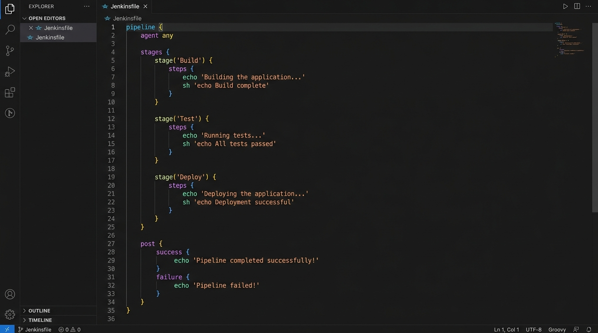
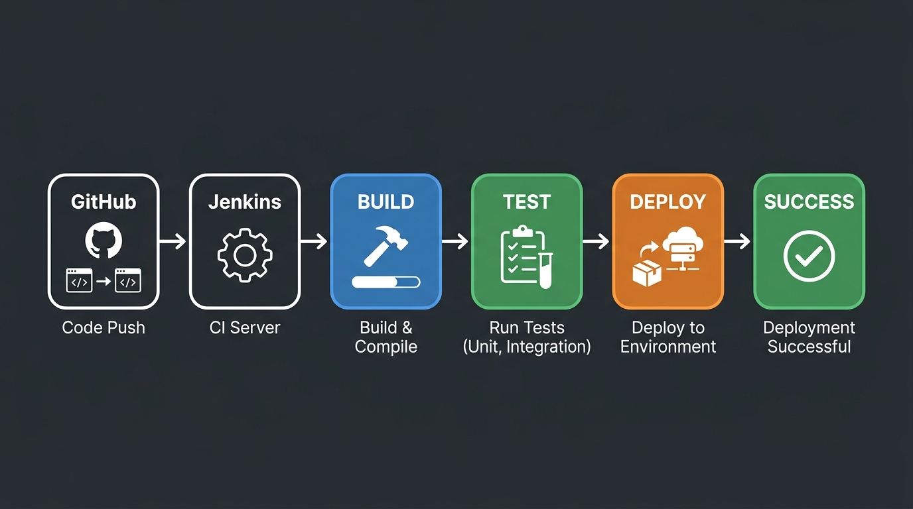

# Lab 1: DevOps Foundations & Continuous Integration

**Name:** Sahil  
**Lab:** Lab 1 — Jenkins CI/CD Pipeline

---

## 1. Jenkinsfile — Pipeline Stages (Build, Test, Deploy)

A declarative `Jenkinsfile` was created with three stages: Build, Test, and Deploy.

**Screenshot of Jenkinsfile:**



```groovy
pipeline {
    agent any

    stages {
        stage('Build') {
            steps {
                echo 'Building the application...'
                sh 'echo Build complete'
            }
        }

        stage('Test') {
            steps {
                echo 'Running tests...'
                sh 'echo All tests passed'
            }
        }

        stage('Deploy') {
            steps {
                echo 'Deploying the application...'
                sh 'echo Deployment successful'
            }
        }
    }

    post {
        success {
            echo 'Pipeline completed successfully!'
        }
        failure {
            echo 'Pipeline failed!'
        }
    }
}
```

---

## 2. Automate Application Deployment

Jenkins was configured with the following:

- **Build Trigger:** Poll SCM (GitHub repository) — `H/5 * * * *`
- **Post-build Action:** Echo deployment status (success/failure)
- **Deployment Step:** The `Deploy` stage in the Jenkinsfile handles deployment automatically after a successful test stage.

**Steps followed:**
1. Created a new Pipeline job in Jenkins
2. Set GitHub repo URL as the source
3. Set branch to `main`
4. Jenkins auto-detects `Jenkinsfile` from the repo root
5. Build runs automatically on each commit

---

## 3. Commands Used

```bash
# Start Jenkins (if running locally)
java -jar jenkins.war

# Check Jenkins status
systemctl status jenkins

# Git commands used
git init
git add Jenkinsfile
git commit -m "Add basic Jenkinsfile"
git push origin main
```

**Pipeline Stages observed in Jenkins UI:**

| Stage  | Status  |
|--------|---------|
| Build  | ✅ Passed |
| Test   | ✅ Passed |
| Deploy | ✅ Passed |

---

## 4. CI/CD Workflow Report

### Pipeline Architecture



### Stages:
| Stage  | Description                        | Status |
|--------|------------------------------------|--------|
| Build  | Compiles/prepares the application  | ✅ Pass |
| Test   | Runs automated test scripts        | ✅ Pass |
| Deploy | Deploys the built artifact         | ✅ Pass |

### Observations:
- Declarative pipeline is easier to read and maintain than scripted
- Post-build actions allow notifications on success/failure
- Poll SCM trigger ensures automatic builds on new commits

---

## 5. Basic Jenkins CI/CD Pipeline — Pull from GitHub

**Jenkins Job Configuration:**
- Type: Pipeline
- Definition: Pipeline script from SCM
- SCM: Git
- Repository URL: `https://github.com/<username>/<repo>.git`
- Branch: `*/main`
- Script Path: `Jenkinsfile`

This ensures every push to the `main` branch triggers a full CI/CD run automatically going through Build → Test → Deploy stages.
